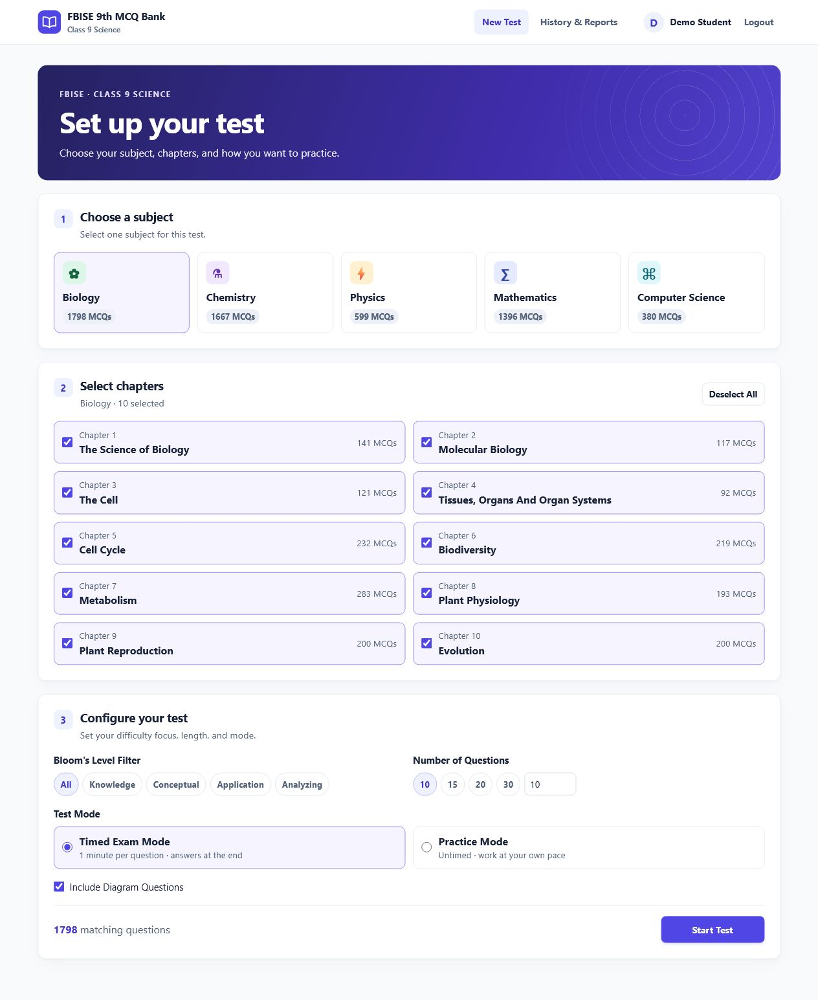
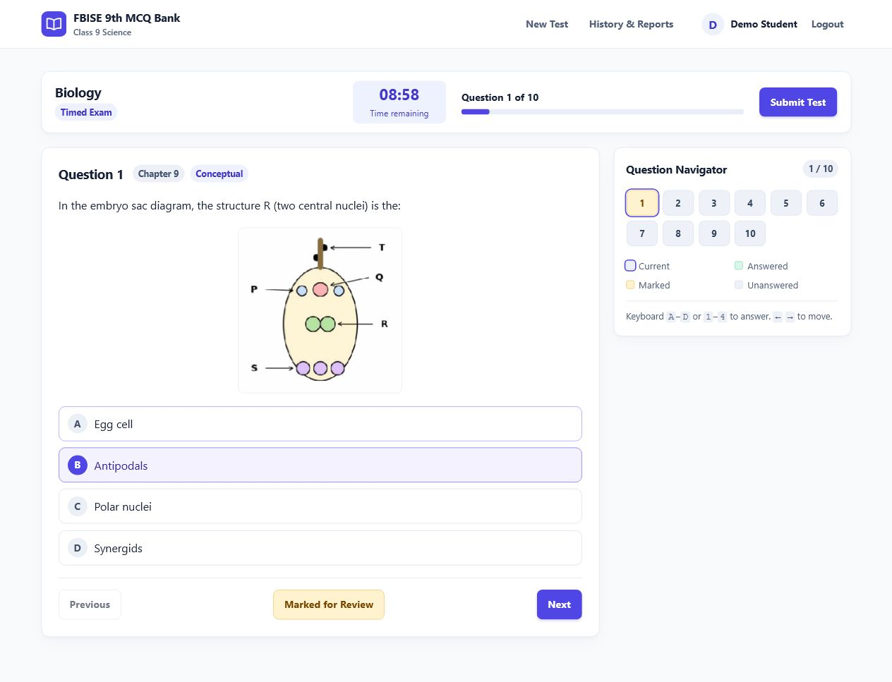
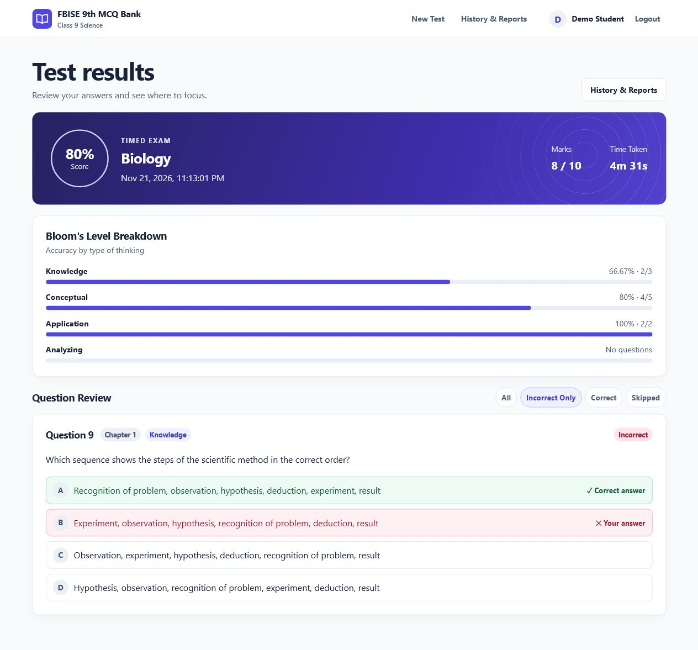
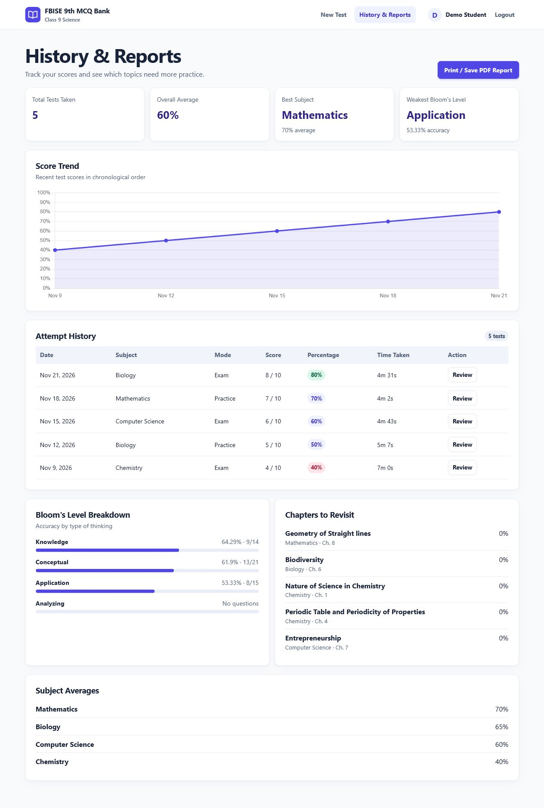
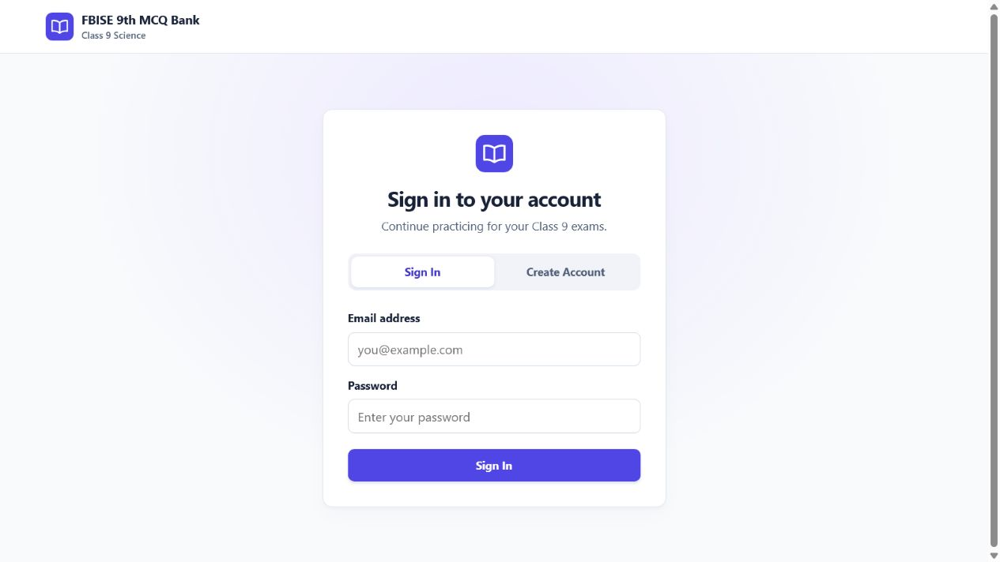

# FBISE Class 9 Science MCQ Bank

An exam practice platform for FBISE Class 9 students studying Biology, Chemistry, Physics, Mathematics, and Computer Science. Students build tests from their chosen chapters, review their answers, and track progress over time.

## Features

- **Custom tests** by subject, chapter, Bloom's Taxonomy level, question count, and diagram preference.
- **Timed exams and untimed practice.** Timed exams allow one minute per question and submit automatically when time runs out. Students can save answers as they go, mark questions for review, and navigate with the keyboard.
- **Answer review** with the correct answers, skipped questions, and a breakdown of accuracy by Bloom's level.
- **Performance reports** with a Chart.js score trend, attempt history, subject averages, chapters to revisit, and an A4 print layout.
- **Student accounts and server-side grading.** The REST API protects personal reports with JWT authentication and makes the answer key available after submission.
- **v2 Admin Panel.** Administrators can review student performance, inspect individual tests, audit the question bank, and monitor site activity.
- **v3 public study portal.** Visitors can browse FBISE subject guides and take free five-question sample quizzes without signing in. Administrators can manage AdSense placements from the Admin Panel.
- **PDF question-bank import** that preserves original question numbers, extracts diagrams, and flags missing or conflicting answers in a CSV report.

The app uses ASP.NET Core MVC and Razor, EF Core with SQLite, and Chart.js. The .NET solution builds both the frontend and backend.

## Screenshots

These screens show a demo student account. Select an image to view it at full size.

| Test setup | Timed exam |
| --- | --- |
| [](docs/screenshots/test-setup.jpg) | [](docs/screenshots/timed-exam.jpg) |

| Answer review | History and reports |
| --- | --- |
| [](docs/screenshots/answer-review.jpg) | [](docs/screenshots/history-and-reports.jpg) |

### Sign-in screen

[](docs/screenshots/sign-in.jpg)

## Getting started

Use the [local run instructions](#3-run-locally) if you already have a populated database. On a fresh clone, follow the database creation and import steps first to populate the test bank.

### Prerequisites

- .NET 8 SDK and ASP.NET Core 8 runtime.
- Python 3.11 or later for importing or backing up the question bank.
- A copy of the source question-bank PDF for import, placed at `tools/MCQs Bank Class 9th.pdf`.

The source repository tracks the app and the import tool. The PDF, generated SQLite database, extracted diagrams, import report, and publish archives are local files excluded by [`.gitignore`](.gitignore). Keep live student data, Visual Studio's local settings, signing keys, and administrator passwords out of GitHub uploads.

Run the commands from the solution directory in PowerShell.

## 1. Create the SQLite database

```powershell
dotnet build McqExamPlatform.sln
dotnet tool install dotnet-ef --tool-path .dotnet-local/tools --version 8.0.34
.\.dotnet-local\tools\dotnet-ef.exe database update --project src/McqExam.Infrastructure --startup-project src/McqExam.WebAPI --no-build
```

The migration creates `src/McqExam.WebAPI/App_Data/mcq_bank.db` and seeds the five subject records. The API also applies migrations at startup and enables SQLite WAL mode. The connection interceptor sets a 5,000 ms busy timeout on every connection. Stop the site before applying a migration manually.

## 2. Import the question bank

```powershell
python -m venv .venv
.\.venv\Scripts\python.exe -m pip install -r tools/requirements.txt
.\.venv\Scripts\python.exe tools/pdf_to_sqlite.py
```

The importer writes valid questions to SQLite, saves embedded diagram crops under `wwwroot/images/diagrams`, and writes a CSV of issues to `tools/validation_report.csv`. Review the CSV before deploying. An import with issues exits with code 1 after writing the report and committing the valid rows. Repeated imports use the same subject, chapter, and question identifiers. Questions linked to attempt history are preserved so their text, options, and answer keys stay consistent with past results.

Run `tools/pdf_to_sqlite.py --help` for alternate PDF, database, diagram, and report paths. The importer expects a text-layer PDF with recognizable tabular structure. The supplied edition has two pages without extractable content and a gap in the Chemical Equilibrium answer key. The CSV identifies the affected records for manual review. Compare diagrams and formula formatting with the PDF when reviewing the bank.

## 3. Run locally

```powershell
dotnet run --project src/McqExam.WebAPI --launch-profile http --urls http://localhost:5080
```

In Visual Studio, open `McqExamPlatform.sln`, set `McqExam.WebAPI` as the startup project, and select the `http` launch profile. Open `http://localhost:5080` and create an account. The app serves the Razor pages, browser assets, and APIs from that address. Development Swagger is available at `http://localhost:5080/swagger`. Development generates a new signing key per process unless you configure one with ASP.NET Core user secrets or `Jwt__Key` in your local environment.

Timed attempts run for one minute per question. The browser saves selections as the student works and auto-submits when the timer reaches zero. The server uses its own clock and allows a five-second delivery window for the final submission. After that window, the server grades the answers it received and saved before the deadline. Practice mode has no deadline.

### v2 Admin Panel

Sign in with an administrator account to open `/admin`. Student accounts receive Access Denied. The Admin Panel includes:

| Page | Reports |
| --- | --- |
| `/admin` | Student and exam totals, 30-day activity, subject averages, and recent attempts |
| `/admin/students` | All students, at-risk and inactive filters, subject breakdown, and test history |
| `/admin/subjects` | Subject performance, Bloom's accuracy, and a chapter weakness heatmap |
| `/admin/questions` | Question accuracy, option choices, suspected wrong keys, and unused questions |
| `/admin/quality` | Duplicate questions, missing diagrams, option issues, and incomplete or unusually fast attempts |
| `/admin/visits` | Login and visit counts, traffic by hour and weekday, and the visit log |
| `/admin/attempts/{id}` | Student details, score, and question-by-question answer review |

Report filters and visit timestamps use UTC. **Export CSV** downloads all matching rows, and **Print / Save PDF** opens an A4 print view of the current report page. Visit tracking starts after the upgrade.

### Configure the administrator account

For a local run, set `Admin:Email` and `Admin:Password` in `src/McqExam.WebAPI/appsettings.Local.json` and restart the app. Create the file with this structure if it is missing. It is excluded from Git and publish output.

```json
{
  "Admin": {
    "Email": "",
    "Password": ""
  }
}
```

Use a password of at most 72 UTF-8 bytes. You can also set `Admin__Email` and `Admin__Password` in the PowerShell session that starts the app. Environment variables override the local JSON settings.

```powershell
$env:Admin__Email = Read-Host 'Admin email'
$adminPassword = Read-Host 'Admin password' -AsSecureString
$env:Admin__Password = [System.Net.NetworkCredential]::new('', $adminPassword).Password
try {
    dotnet run --project src/McqExam.WebAPI --launch-profile http --urls http://localhost:5080
} finally {
    Remove-Item Env:Admin__Email, Env:Admin__Password
}
```

For a persistent local configuration, use ASP.NET Core User Secrets for the `McqExam.WebAPI` project with the keys `Admin:Email` and `Admin:Password`. For IIS or Plesk, use per-site environment variables or the deployed [`web.config` example](#generate-and-configure-the-jwt-signing-key).

On startup, the app applies database migrations, then creates an Admin account if the configured email is new. An existing student account can be promoted using its current password, which preserves the account ID and exam history. A mismatched password for that account stops startup. Once the account has the Admin role, subsequent startups leave its password hash intact. The seed settings can be removed after provisioning, and the seeded account can continue signing in.

### v3 public portal and ads

The home page at `/` introduces the subject guides at `/subjects`, the `/fbise-slo-guide` article, and the sample quizzes at `/sample-quiz/{subject}`. The footer links to About, Contact, Privacy Policy, and Terms. Subject guides show live chapter coverage and approximate Bloom’s percentages. Exact question-bank counts remain in the Admin Panel.

- Set `PublicSite__BaseUrl` to the deployed site URL, such as `https://study.example.com`, for canonical URLs, Open Graph metadata, and `/sitemap.xml`. Without this setting, those URLs use the incoming request origin. `/robots.txt` points to the sitemap and excludes student exam, admin, and API routes.
- Set `PublicSite__SupportEmail` to the address you want shown on `/contact`. The form validates and saves inquiries to the `ContactInquiries` table in the application’s SQLite database. It does not send email. The table is added on startup by migration.
- Sample quizzes use a 30-minute protected ticket and are graded on the server. Configure the ASP.NET Core Data Protection key store for the deployed application identity if tickets need to survive process restarts. Sample attempts have no student history record.

Ads start disabled. Sign in as an administrator and open **Ad Settings** at `/admin/ads` to set the publisher ID, configure individual placements, and test `/ads.txt`. Leave the text box blank to generate the Google entry from the publisher ID. Enable the global switch and **Preview placeholder mode** to check spacing with an Admin account without requesting ads.

For a live native Answer Review in-feed unit, set `Ads__ReviewInFeedLayoutKey` to the layout key from your AdSense unit. Before activating the exam sidebar, exclude the `/exam/` section in Google’s Auto Ads settings so Google cannot add placements near exam controls. [Google in-feed setup](https://support.google.com/adsense/answer/9189560) · [Google Auto Ads page exclusions](https://support.google.com/adsense/answer/9262311)

## 4. Build and publish for IIS or Plesk

### Upload the prepared release

If you have the prepared `FBISE-MCQ-Plesk.zip`, extract it into the domain's document root in Plesk, usually `httpdocs`. The ZIP opens directly to `web.config`, `McqExam.WebAPI.dll`, `wwwroot`, and `App_Data`. It includes a fresh question bank and diagrams. For a first deployment using this ZIP, start with the [IIS setup](#configure-iis). To publish the v3 portal and Ad Settings, build from source using the steps below.

### Build a new release from source

```powershell
dotnet publish src/McqExam.WebAPI -c Release -o artifacts/site
```

Visual Studio can also publish `McqExam.WebAPI` using a **Folder** profile in **Release**. Publishing compiles the Razor views, copies browser assets and imported diagrams from `wwwroot`, and creates the IIS `web.config`. MVC serves deep links such as `/history` and `/admin/students` directly.

For a first deployment, use a database that contains only the question bank. Stop local processes using it, checkpoint the WAL, and copy it into the release folder.

```powershell
$source = 'src/McqExam.WebAPI/App_Data/mcq_bank.db'
.\.venv\Scripts\python.exe -c "import sqlite3,sys; db=sqlite3.connect(sys.argv[1]); assert db.execute('PRAGMA wal_checkpoint(TRUNCATE)').fetchone()[0] == 0; db.close()" $source
New-Item -ItemType Directory -Force artifacts/site/App_Data | Out-Null
Copy-Item -LiteralPath $source -Destination artifacts/site/App_Data/mcq_bank.db
```

### Configure IIS

1. Install the ASP.NET Core 8 Hosting Bundle on Windows, or verify your Plesk plan provides the ASP.NET Core 8 runtime and IIS module.
2. Point the IIS or Plesk site at the published folder and enable HTTPS. Use one application pool worker with **No Managed Code** and an application identity dedicated to the site.
3. Grant the application pool identity **Modify** permission on `App_Data` so SQLite can create its WAL and shared-memory files. Give the worker read access to the rest of the release. If keeping data in a persistent external directory, set `Database__Path` to its absolute database path and grant permissions there.
4. Configure `Jwt__Key` using the steps below. To provision an administrator, also set `Admin__Email` and `Admin__Password`.
5. Stop the site and back up the live SQLite database before upgrading. Retain the deployed `App_Data` or configured `Database__Path` when replacing application files. The first v2 startup adds the user role and login fields and creates the visit log table while preserving existing IDs and records. Deploy updated questions by running the importer against the live database during maintenance, with `--db` and `--diagrams` pointing at the live paths.
6. Start the site. Sign in as an administrator and open `/admin`. With a separate student sign-in, take a short test, open the history print preview, and check that `/admin` shows Access Denied.

The project targets .NET 8 as specified. Microsoft ended support for .NET 8 and .NET 9 on November 10, 2026. Use a supported runtime for a public deployment after retargeting and testing the application. See the [Microsoft .NET support policy](https://dotnet.microsoft.com/en-us/platform/support/policy/dotnet-core).

### Generate and configure the JWT signing key

Generate one key per deployed site in a private PowerShell session.

```powershell
$bytes = New-Object byte[] 32
$rng = [System.Security.Cryptography.RandomNumberGenerator]::Create()
try { $rng.GetBytes($bytes) } finally { $rng.Dispose() }
[Convert]::ToBase64String($bytes)
```

Copy the full output, including any trailing `=`, and save a backup in a password manager. If your hosting provider lets you set per-site IIS environment variables, set `Jwt__Key` to that value there. Otherwise, open the deployed `web.config` beside `McqExam.WebAPI.dll` in Plesk File Manager and replace its self-closing `<aspNetCore ... />` element with this block. Paste the key in place of the placeholder. Include the two Admin entries only when provisioning an account, and XML-escape characters such as `&` and `"` in attribute values.

```xml
<aspNetCore processPath="dotnet"
            arguments=".\McqExam.WebAPI.dll"
            stdoutLogEnabled="false"
            stdoutLogFile=".\logs\stdout"
            hostingModel="inprocess">
  <environmentVariables>
    <environmentVariable name="Jwt__Key" value="PASTE_YOUR_GENERATED_KEY_HERE" />
    <environmentVariable name="Admin__Email" value="ADMIN_EMAIL_HERE" />
    <environmentVariable name="Admin__Password" value="ADMIN_PASSWORD_HERE" />
  </environmentVariables>
</aspNetCore>
```

Keep the real key and any seed credentials on the server and out of Git and shared release ZIPs. If an upload replaces the deployed `web.config`, restore the entry with the same key before starting the site. Changing the key invalidates existing sign-ins. [Microsoft IIS configuration guide](https://learn.microsoft.com/en-us/aspnet/core/host-and-deploy/aspnet-core-module?view=aspnetcore-10.0#set-environment-variables)

## Architecture

- `Domain` contains the entities and enums.
- `Application` defines request and response contracts, persistence interfaces, grading, and report calculations.
- `Infrastructure` implements EF Core persistence, BCrypt hashing, and JWT issuance.
- `WebAPI` hosts the JWT-protected APIs and Razor pages. Browser JavaScript in `wwwroot/js` calls the APIs and handles the interactive exam and Chart.js report.
